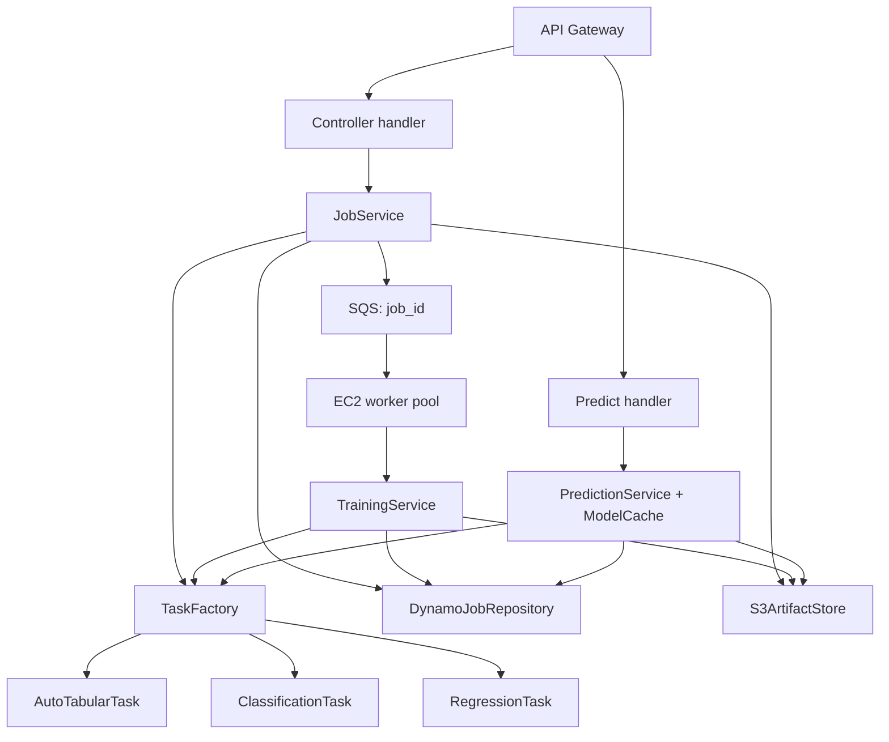

# Kiến trúc nhiều ML task

Hỗ trợ `classification`, `regression` và `tabular` tự suy luận. Các task cùng dùng
AutoGluon Tabular + LightGBM, không thêm dependency ML. Time-series/image/NLP chưa triển khai.



## Trách nhiệm và pattern

| Layer / pattern | Vai trò |
| --- | --- |
| `TaskFactory` — Factory/Registry | Ánh xạ tên task đã cho phép sang strategy; từ chối task lạ trước khi ghi AWS. |
| `MLTask` — Strategy | Contract `validate_training`, `validate_prediction`, `train`, `load`, `predict`. |
| `TabularTask` — Template Method | Dùng chung pipeline AutoGluon; subclass thay quy tắc target và `problem_type`. |
| Services | Điều phối submit/train/deploy/predict; không import boto3, pandas hay AutoGluon. |
| Repository / adapters | Đóng gói DynamoDB, S3, SQS; implement các `Protocol` trong `domain.py`. |
| `runtime.py` — Dependency Injection | Khởi tạo adapters và truyền dependencies vào services; tests thay strategy/cache/storage độc lập. |

ML dependencies chỉ được import khi train/load/predict. Lambda controller có thể validate
request và chọn strategy mà không khởi tạo AutoGluon. Handler chỉ dịch HTTP và gọi service.

## Luồng và khả năng xử lý nhiều job

1. `JobService.submit` parse request, factory chọn task và validate CSV; lưu CSV vào S3,
   lưu `task`, `target`, `time_limit` vào DynamoDB, gửi `job_id` vào SQS.
2. EC2 worker gọi `TrainingService`. Conditional update claim job bằng lease + owner token.
   Strategy train vào thư mục tạm; adapter đóng gói ZIP và upload artifact riêng cho từng attempt.
3. Chỉ owner hiện tại được ghi `COMPLETED`/`FAILED`. Worker cũ hết lease không thể ghi đè
   kết quả hoặc artifact của attempt mới. Delivery trùng đang được xử lý không được ack.
4. Deploy lưu cả `task` và `model_key`. Predict chọn strategy tương ứng để load và chạy model.
   Cache giữ một model, dùng `(task, model_key)` làm key và thay model khi chuyển deployment.

Một worker xử lý một job tại một thời điểm; ASG cho phép nhiều worker xử lý nhiều job song song.
Classification và regression dùng chung resource profile, queue và image. Nếu thêm task GPU
hoặc task có thời gian chạy dài, cần thiết kế queue/pool/timeout riêng; factory không tự làm việc đó.
SQS vẫn là at-least-once; lease hiện tại cố định khoảng một giờ, không có heartbeat gia hạn.
Job/deployment cũ không có `task` được hiểu là `tabular`.

## Thêm một task

1. Tạo subclass `MLTask` trong `app/tasks/`; dùng `TabularTask` nếu vẫn là tabular.
2. Implement validation, train, load, predict. `train` phải ghi toàn bộ model vào `model_dir`;
   `predict` trả dict JSON-serializable. Giữ AWS SDK ngoài strategy.
3. Đăng ký trong `default_factory()`:

   ```python
   factory.register("my_task", MyTask)
   ```

4. Thêm tests và smoke data; thêm dependencies nếu cần rồi rebuild/deploy **cùng một image**
   cho controller, worker và predict. Nếu input không còn là CSV + target, mở rộng
   `TrainingRequest` và metadata job tương ứng.

Không cần thêm `if task == ...` vào worker hoặc handler. Với các tabular strategy hiện có,
API/AWS infrastructure giữ nguyên. Artifact phải được load bằng cùng phiên bản AutoGluon đã train.

## Kiểm chứng

`tests/test_tasks.py` kiểm tra target rules, factory extension và cách chọn AutoGluon problem type.
`tests/test_flow.py` dùng Moto và strategy nhẹ để kiểm tra mixed jobs qua S3/DynamoDB,
deploy → predict, đổi cache, backward compatibility và tranh chấp lease.
Các test này không thay thế train ML thật: dùng `python3 scripts/smoke.py --task all`
trên Docker/AWS để chạy hai pipeline AutoGluon thực tế.

AutoGluon API: [problem types](https://auto.gluon.ai/1.4/_modules/autogluon/tabular/predictor/predictor.html).
